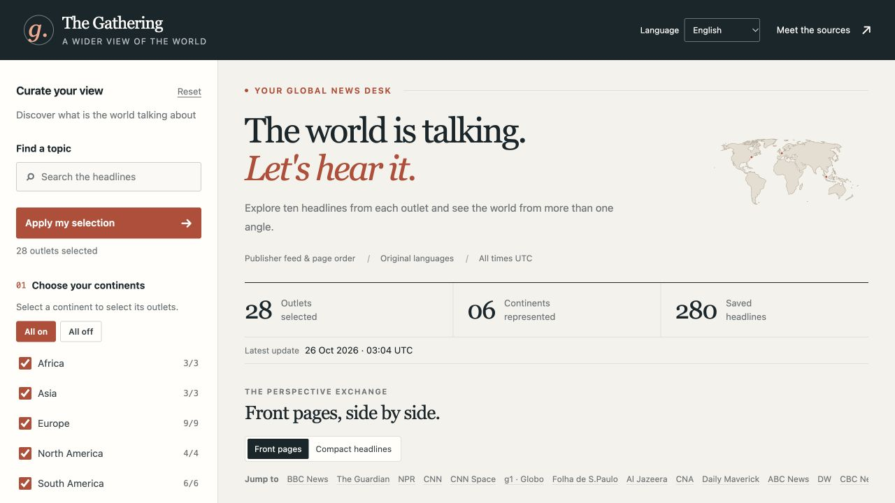
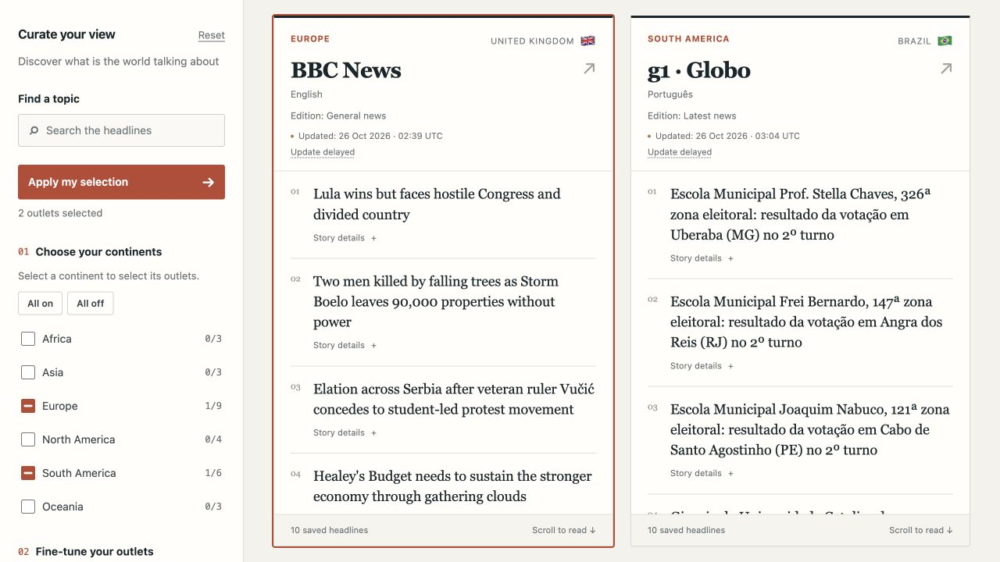
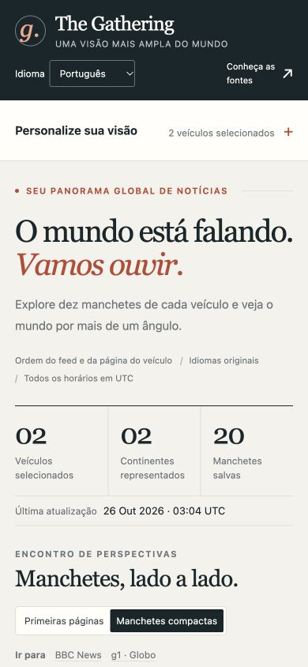

<p align="center">
  
</p>
<h1 align="center">News, The Gathering</h1>
<p align="center"><strong>A wider view of the world.</strong><br>Compare ten headlines from news outlets across six continents.</p>
<p align="center">
  <a href="#features">Features</a> ·
  <a href="#quickstart">Quickstart</a> ·
  <a href="#how-it-works">How it works</a> ·
  <a href="#documentation">Documentation</a>
</p>



A Python and Django news desk with **28 source sections from 27 organizations**.
Choose places and publishers, compare their priorities, and read the news in its
original language. The interface is available in **English and Portuguese**.

<details>
<summary>See the comparison and mobile views</summary>

**Outlets side by side**



**Portuguese interface on a phone**



Screenshots show saved publisher editions; headlines change as collection runs.

</details>

## Features

- **Compare perspectives:** filter by continent and outlet, then switch between
  front-page cards and compact headlines. Selections can be bookmarked.
- **Find a topic:** search current titles and summaries without changing the
  publisher's words or translating the news.
- **Read anywhere:** responsive layouts, keyboard-accessible controls, country
  flags and collection timestamps.
- **Collect independently:** publisher feeds and section pages update the
  database in the background; failed collections keep the last good edition.
- **Keep storage manageable:** local SQLite storage, deduplicated articles,
  bounded edition history and compressed, rotating backup commands.
- **Suggest sources:** readers can submit outlet recommendations for private
  review.

## Quickstart

Requires **Python 3.12**. From the project folder, using a macOS/Linux shell:

```bash
python3.12 -m venv .venv-django
source .venv-django/bin/activate
python -m pip install -r requirements.txt
export DJANGO_DEBUG=true
python -m news.maintenance init
python -m news.collect
python manage.py runserver 127.0.0.1:8000
```

Open [localhost:8000](http://127.0.0.1:8000/). To refresh the news automatically,
open another terminal in the same folder:

```bash
source .venv-django/bin/activate
export DJANGO_DEBUG=true
python -m news.collect --interval 30
```

This waits **30 minutes after each collection run**. The web server and collector
are separate processes. Existing installations should follow the
[database upgrade steps](docs/project-guide.md#upgrade-an-existing-database)
before initialization.

## How it works

```text
Publisher feeds / pages → Python collectors → SQLite → Django website
```

“Top ten” follows publisher feed or section-page order; it is not a popularity
ranking. Outlet names and news content stay in their original languages. Each
card identifies the outlet's home country, edition scope and last update.

SQLite stores local data in `data/news.db`, which is ignored by Git. History
defaults to **30 days and at most 48 changed editions per outlet**; current headlines remain protected from pruning. Page
requests never launch collectors or run database migrations.

## Documentation

| Guide | Contents |
| --- | --- |
| [Project guide](docs/project-guide.md) | Collection options, filters, upgrades, retention, backups and code map |
| [Deployment guide](docs/deployment.md) | Django production settings, Docker, SQLite storage and recovery |
| [Source catalog](news/sources.py) | Add or edit outlets, languages and edition scopes |
| [Configuration example](.env.example) | Available environment variables |

The local commands above enable development mode. Production requires a private
`DJANGO_SECRET_KEY`, explicit host settings and HTTPS configuration; Django does
not load `.env` automatically. See the deployment guide before publishing.

## Development

Run the main regression suite in the activated environment:

```bash
DJANGO_DEBUG=true python -m unittest discover -s tests -v
```

Tests use isolated databases and mocked publisher requests. The
[validation guide](docs/project-guide.md#validate) covers Django checks and the
separate browser suite. The [CI workflow](.github/workflows/checks.yml) defines the unit and Chromium
browser checks.
